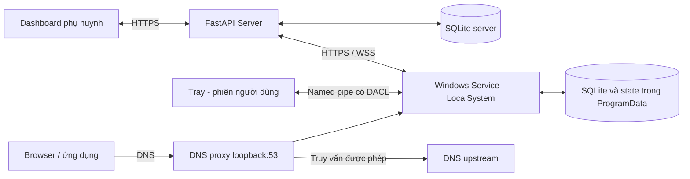

# Kiến trúc OpenGuard Kids

## Thành phần và biên tin cậy

Dashboard nằm trong `server/dashboard/`; service và Tray thuộc `agent/`. Service thực thi policy, đếm usage, giám sát process, phục vụ DNS, đồng bộ sự kiện và lệnh. Tray giải thích trạng thái và gửi yêu cầu qua IPC, không sở hữu token server. User thường không được sửa thư mục dữ liệu/source hoặc quản trị service.

Watchdog xác minh Tray do nó khởi chạy và trạng thái icon. Nếu không thể xác nhận icon trong 30 giây ở desktop đang đăng nhập, runtime dừng và phục hồi mạng; không duy trì bảo vệ ẩn. Cần nghiệm thu hành vi SCM/ACL/desktop trên Windows thật.

## Giao thức và vòng đời

| Luồng | Hành vi |
| --- | --- |
| Ghép đôi | Parent xác nhận notice, tạo mã 8 ký tự có TTL 10 phút; server giữ hash, claim một lần; trả device/access/refresh token |
| Heartbeat | Mặc định 60 giây, gửi trạng thái/usage/policy version; nhận giờ server và lệnh chờ |
| Policy | Có version và HMAC-SHA256; WebSocket thông báo policy mới, heartbeat fallback; agent xác minh rồi lưu bản tốt gần nhất |
| Command | WebSocket gửi nhanh; pending/sent được gửi lại cùng ID khi reconnect/heartbeat tới khi ACK terminal |
| Event | UUID event ID → SQLite outbox → batch upload → ACK từng event → xóa/đánh dấu đã gửi; chỉ xử lý các ID được ACK |
| Yêu cầu trẻ | Xin thêm giờ hoặc báo chặn nhầm → parent quyết định/lời nhắn → command phản hồi; sửa rule là thao tác riêng |
| Xóa dữ liệu | Xóa hồ sơ server → receipt hash → agent reconnect, dừng collectors, wipe và ACK; mất ACK chỉ retry, không thu thập lại |

WebSocket dùng TCP nhưng vẫn cần ACK ứng dụng: đứt kết nối không cho biết chắc agent đã thực thi hay chưa. Server cung cấp giao hàng ít nhất một lần; agent dùng ID và transaction cục bộ để chống chạy lặp. Mục tiêu đề bài là policy dưới 60 giây và lệnh khẩn dưới 5 giây; cần đo thực tế, không suy ra từ việc dùng WebSocket.

## Thiết kế dữ liệu

| Nhóm | Entity/trạng thái chính |
| --- | --- |
| Tài khoản | User, WebSession; parent, child-view, admin |
| Trẻ và thiết bị | Child, Device, Enrollment; một parent có nhiều trẻ, mỗi trẻ nhiều thiết bị |
| Chính sách/điều khiển | Policy, ChildRequest, DeviceCommand, PolicyAudit, ControlAudit |
| Hoạt động | ActivityEvent, ScreenUsageDaily |
| Xóa dữ liệu | ErasureJob độc lập hồ sơ đã xóa, chỉ giữ receipt/token hash tới ACK |
| Agent local | Policy cache, UsageDaily, Event outbox, ProcessedCommand, AppUsageDaily, clock anchor và grace state |

Activity chứa loại sự kiện, subject đã tối thiểu hóa, thời điểm, duration, device/child/policy ID và event ID chống trùng. Server giữ `occurred_at`, `received_at`, `effective_at`, `clock_trusted` để phân biệt giờ agent và giờ dùng báo cáo. Xem [bảng quyền riêng tư](PRIVACY.md) cho mục đích, quyền xem và retention.

AES-GCM mã hóa các trường định danh nhạy cảm, phản hồi, command payload và control audit; email lookup bằng HMAC. Đây không phải mã hóa toàn DB. Agent state chứa token được AES-GCM bảo vệ, khóa Windows được DPAPI bọc. ACL hạn chế SYSTEM/Administrators. Khóa server nằm ngoài source và phải được giữ qua migration/backup restore.

## Thời gian và ngoại tuyến

- Wall clock agent không phải nguồn tin cậy để cấp quota. Server UTC là mốc tham chiếu; monotonic đo elapsed usage.
- Heartbeat đối chiếu clock, mặc định ngưỡng 120 giây. Clock lệch vẫn có thể nhận HTTP 200 để lấy giờ server; request hợp lệ không đồng nghĩa clock được tin cậy.
- Anchor + monotonic dùng cho ngày quota/lịch. Restart trong cùng boot có thể khôi phục anchor; sau reboot offline mặc định `OGK_OFFLINE_CLOCK=strict` chờ xác minh. Policy cache chưa có giờ tin cậy có khoảng chờ khởi tạo tối đa 30 giây trước khóa; lệnh khóa lưu trước đó có thể áp dụng ngay.
- Usage, grace và command IDs được lưu để restart không cấp thêm giờ hay thực thi lệnh hai lần.
- `OGK_POLICY_OFFLINE_DAYS=7`: quá hạn heartbeat thì khóa screen-time tới khi reconnect, vẫn giữ bộ lọc theo policy đã xác minh. Đây là fail-closed cho screen-time.
- Mất mạng trong khi có anchor hợp lệ: tiếp tục đếm thời gian, áp policy, lưu event và retry sau. Clock không tin cậy có thể trì hoãn cleanup cục bộ thay vì xóa sai dữ liệu.

Kiểm tra chỉnh giờ phải dùng server có đồng hồ độc lập; Docker trên cùng host thường không tạo một đồng hồ độc lập để thử kiểu này. Đo quota trước/sau chỉnh giờ, quan sát drift và kiểm tra restart/reboot; khôi phục giờ sau thử nghiệm.

## Kiểm soát ứng dụng và DNS

Process monitor lấy executable name/path để xác định ứng dụng, cache SHA-256 và match hash trước tên. Đổi tên executable không đổi hash của cùng nội dung file. App duration là vòng đời process, chưa phải foreground activity; nhiều process đồng thời khiến tổng app duration khác screen time. Không lấy window title hay nội dung tài liệu.

DNS proxy kiểm tra safety exemptions trước policy; sau đó `explicit allow > explicit block > category > default allow`. Bộ phân loại có sáu nhóm và dữ liệu nộp kèm tại [DOMAIN_CATEGORIES.md](DOMAIN_CATEGORIES.md). SafeSearch rewrite DNS cho engine hỗ trợ, không giải mã HTTPS. Telemetry dùng registrable domain, không URL đầy đủ; exemption trợ giúp không sinh activity.

Kết nối HTTPS đang mở không bị chấm dứt khi rule DNS thay đổi. Browser cache, DoH/DoT, VPN và IP trực tiếp có thể tránh proxy. Network guard quản lý DNS/firewall/browser và backup trước thay đổi; lúc dừng phục hồi cấu hình cũ. Không khẳng định ngăn mọi bypass.

## Giới hạn và nghiệm thu

Các sơ đồ Mermaid bổ trợ nằm trong [diagrams/](diagrams/): luồng service/Tray,
policy, command, screen-time và clock. Đây là sơ đồ từng cơ chế, cần đọc cùng
vòng đời và giới hạn trong tài liệu này.

SQLite phù hợp deployment nhỏ; WebSocket manager/rate limit trong memory cần một worker. Dataset tĩnh cần rà soát. Tài khoản administrator, Safe Mode, boot USB hoặc OS bị chiếm không nằm trong bảo đảm chống sửa cục bộ.

DNS miễn chặn `tongdai111.vn`, `moet.gov.vn` và các cổng trường được cấu hình; điều này không tự cho phép duyệt web khi desktop khóa. Khả năng gọi/truy cập trợ giúp khẩn cấp trên thiết bị thực phải kiểm chứng riêng. Agent offline chưa thể xác nhận xóa dữ liệu; backup ngoài hệ thống không tự bị xóa.

Phụ lục kỹ thuật nộp riêng cần đủ M1–M6: luồng gói có capture; so sánh hosts/DNS/proxy/WFP; ít nhất bảy bypass kèm kết quả thật; CPU/RAM/DNS p50-p95/policy latency với tối thiểu 30 mẫu; mất mạng/server/agent và thời gian phục hồi; đồng bộ thời gian. Tài liệu này giải thích thiết kế, không thay phép đo và evidence.
